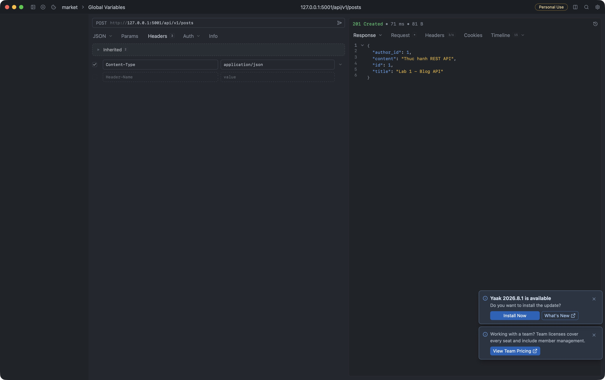
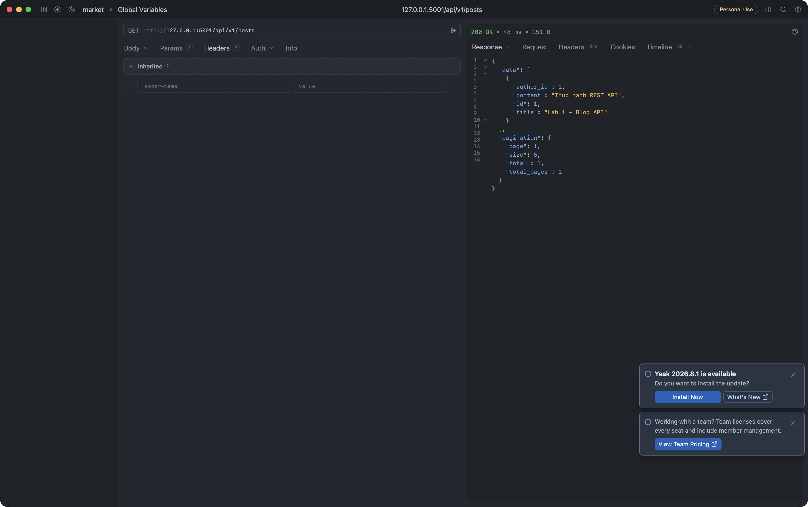

# Blog API routes

Tiền tố `/api/v1`

```text
/posts                              GET, POST
/posts/{post_id}                    GET, PUT, PATCH, DELETE
/posts/{post_id}/comments           GET, POST
/posts/{post_id}/comments/{comment_id} GET, PATCH, DELETE
/posts/{post_id}/tags               GET
/posts/{post_id}/tags/{tag_id}      PUT, DELETE
/tags                               GET, POST
/tags/{tag_id}                      GET, PATCH, DELETE
/users                              GET, POST
/users/{user_id}                    GET, PATCH
/users/{user_id}/posts              GET
/users/{user_id}/following          GET
/users/{user_id}/following/{target_id} PUT, DELETE
/users/{user_id}/followers          GET
```

`posts`, `tags` và `users` là các collection; URI có ID là item. Bình luận nằm dưới bài viết, còn tag có collection riêng vì một thẻ dùng được cho nhiều bài. `following` biểu diễn quan hệ theo dõi; `followers` là chiều ngược lại

## Sơ đồ tài nguyên và version

Dùng `/api/v1` để dành chỗ cho phiên bản mới có breaking change.

```text
/api/v1
├── posts                         collection: GET, POST
│   └── {post_id}                 item: GET, PUT, PATCH, DELETE
│       ├── comments              sub-resource collection: GET, POST
│       │   └── {comment_id}      sub-resource item: GET, PATCH, DELETE
│       └── tags                  quan hệ nhiều-nhiều: GET
│           └── {tag_id}          gắn/bỏ gắn thẻ: PUT, DELETE
├── tags                          collection: GET, POST
│   └── {tag_id}                   item: GET, PATCH, DELETE
└── users                         collection: GET, POST
    └── {user_id}                 item/hồ sơ: GET, PATCH
        ├── posts                 sub-resource collection: GET
        ├── followers             sub-resource collection: GET
        └── following             sub-resource collection: GET
            └── {target_id}       quan hệ theo dõi: PUT, DELETE
```

Resources: user, post, comment, tag. Follow là quan hệ giữa hai user;
PUT vào URI của quan hệ có tính idempotent, gửi lại không tạo thêm lượt follow.
Tag dùng chung giữa các bài; xóa quan hệ `/posts/{id}/tags/{tag_id}` không xóa tag.
Đối với comment có ID duy nhất toàn hệ thống, có thể dùng `/comments/{id}` để giảm nesting.
Các endpoint trên là thiết kế; phần triển khai theo đề Lab 1 gồm **GET và POST collection `/api/v1/posts`**.

## Chạy và kiểm thử

Từ thư mục repository, sau khi cài môi trường theo [README chung](../README.md):

```bash
lecture3/.venv/bin/python lecture3/b1/app.py
curl -i -X POST http://127.0.0.1:5001/api/v1/posts \
  -H 'Content-Type: application/json' \
  -d '{"author_id":1,"title":"Lab 1 - Blog API","content":"Thuc hanh REST API"}'
curl 'http://127.0.0.1:5001/api/v1/posts?author_id=1&page=1&size=5'
```

POST trả `201 Created`, body bài viết và `Location: /api/v1/posts/{id}`.
GET trả `200`, `data` và `pagination`; `page` và `size` dùng để phân trang.
Giả định body và tham số đầu vào hợp lệ.
Dữ liệu lưu trong bộ nhớ và mất khi khởi động lại.

## Minh chứng Yaak (06/10/2026)

POST tạo bài viết trả 201:



GET lọc theo tác giả và phân trang trả 200:


