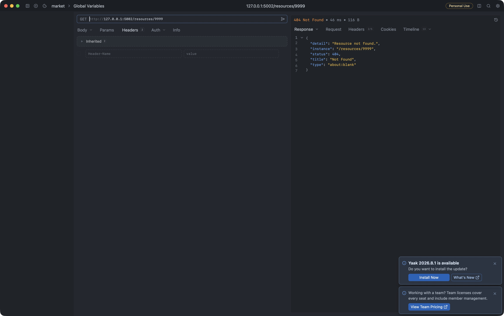
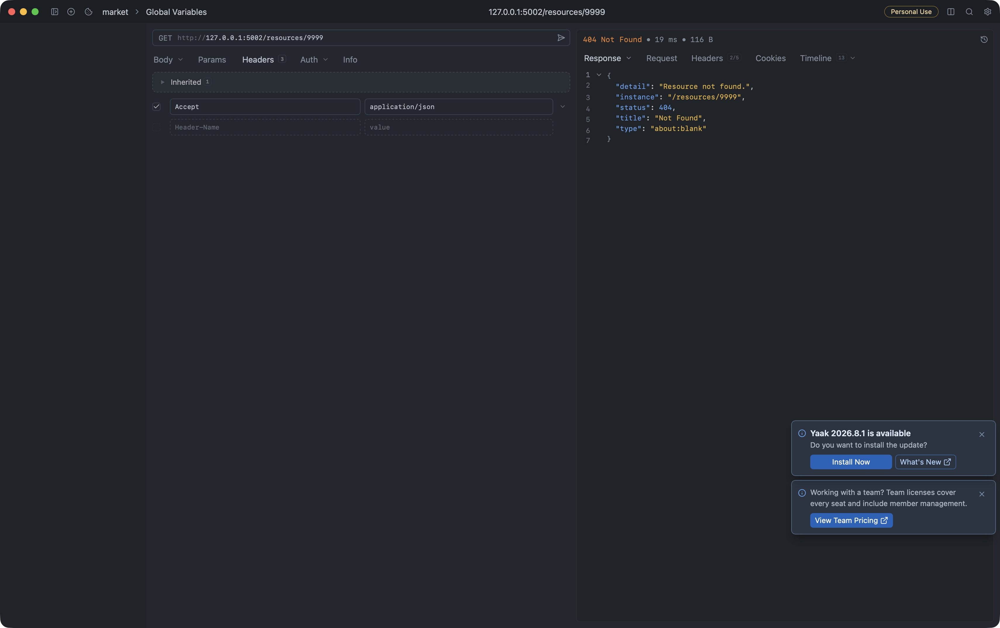

# Lab 2 - Flask Problem Details

`ProblemError(status, title, detail)` biểu diễn lỗi nghiệp vụ.
Handler cho `ProblemError`, `HTTPException` và exception chưa xử lý đều trả
`application/problem+json` với `type`, `title`, `detail`, `status`, `instance`.
HTTP status trùng với `status` trong body. Lỗi không phụ thuộc `Accept` của client.
Exception chưa bắt trả message trung tính, còn stack trace được log phía server.

## Chạy

Từ repository, cài môi trường theo [README chung](../README.md), rồi:

```bash
lecture3/.venv/bin/python lecture3/b2/app.py
curl -i http://127.0.0.1:5002/resources/1
curl -i http://127.0.0.1:5002/resources/9999
curl -i http://127.0.0.1:5002/resources/9999 -H 'Accept: application/json'
```

| Trường hợp | Kết quả |
| --- | --- |
| `/resources/1` | 200, resource mẫu |
| `/resources/9999` | 404, problem+json |
| URL không có route | 404, problem+json |
| POST vào route chỉ hỗ trợ GET | 405, problem+json |
| Exception chưa bắt (chỉ inject trong test) | 500, không lộ thông tin nội bộ |

Route gây lỗi 500 chỉ được tạo trong bộ test, không mở trong app chạy bình thường.

## Minh chứng Yaak (06/10/2026)

Không có `Accept`, lỗi 404 vẫn có đủ 5 trường:



Client gửi `Accept: application/json`, body lỗi vẫn là Problem Details:



Bộ test tự động xác nhận Content-Type chính xác là `application/problem+json`
cho cả không có Accept, Accept JSON và Accept HTML, cùng fallback 404/405/500.
