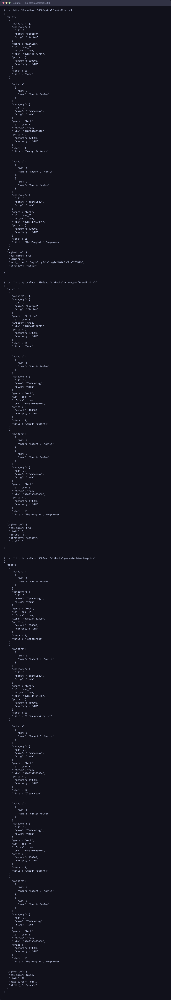

# Lecture 5 - Data Modeling & Resource Design

## Bài 1
Xem `resource_design.md` và `schemas/`

## Bài 2 - Pagination

```
pip install -r requirements.txt
python app.py
```

```
curl "http://localhost:5000/api/v1/books?limit=3"
curl "http://localhost:5000/api/v1/books?strategy=offset&limit=3"
curl "http://localhost:5000/api/v1/books?genre=tech&sort=-price"
```

```
pytest tests/ -v
```

## Proof


