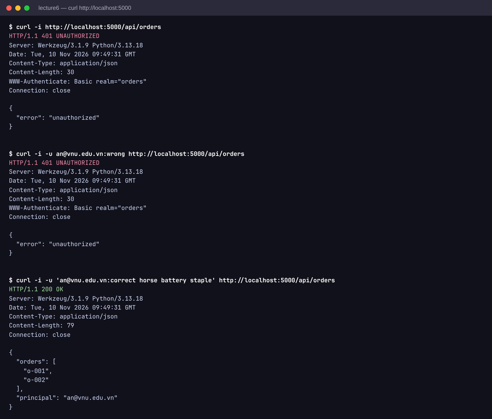
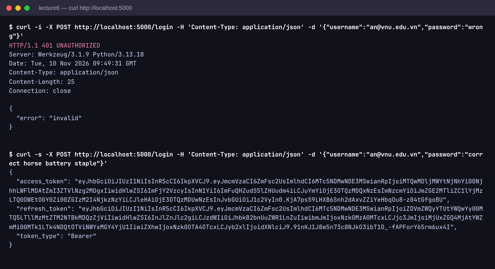
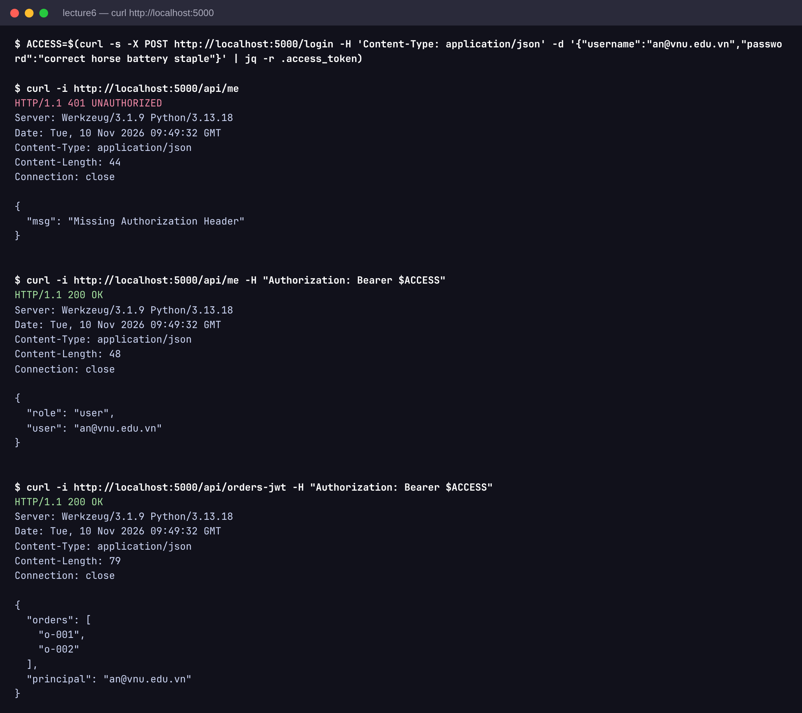
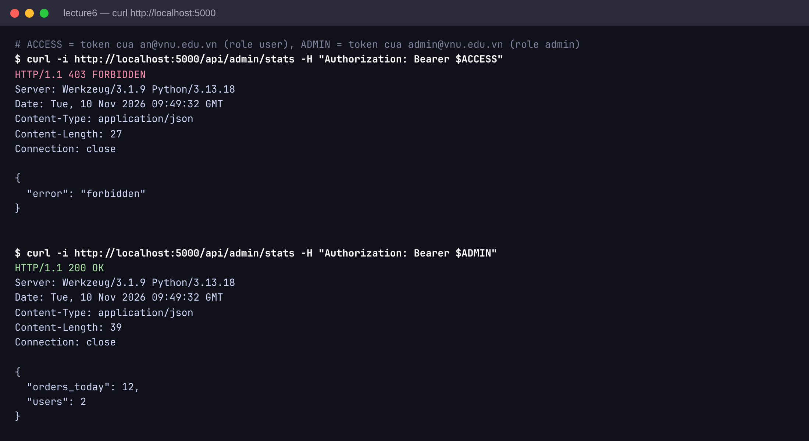
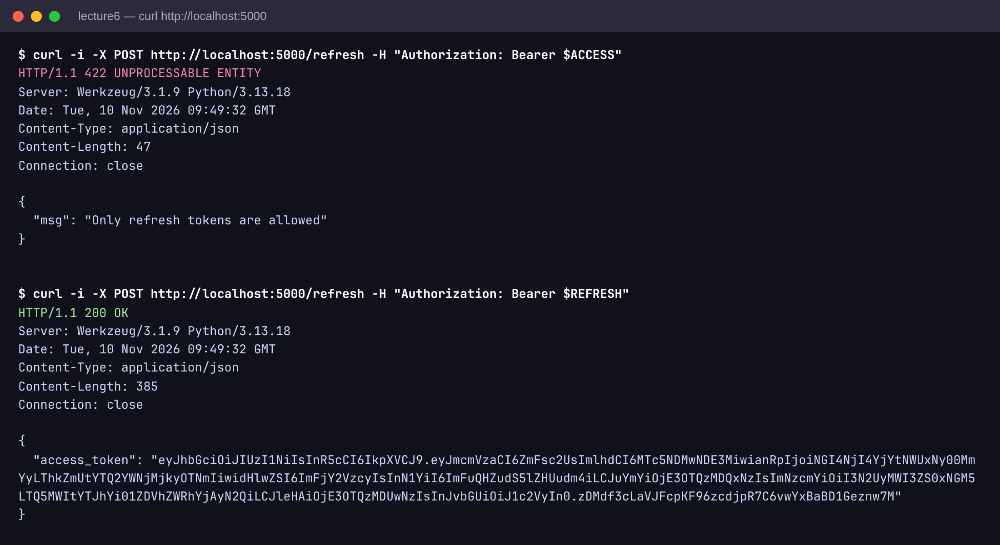

# Lecture 6 - Authentication & Authorization

## Chay app

```
pip install -r requirements.txt
python app.py
```

## Basic Auth

```
curl -u an@vnu.edu.vn:correct\ horse\ battery\ staple http://localhost:5000/api/orders
curl -u admin@vnu.edu.vn:adminpass123 http://localhost:5000/api/orders
```

## JWT

Login:

```
curl -X POST http://localhost:5000/login \
  -H "Content-Type: application/json" \
  -d '{"username":"an@vnu.edu.vn","password":"correct horse battery staple"}'
```

Dung access token:

```
curl http://localhost:5000/api/me -H "Authorization: Bearer <access_token>"
curl http://localhost:5000/api/orders-jwt -H "Authorization: Bearer <access_token>"
```

Admin only:

```
curl http://localhost:5000/api/admin/stats -H "Authorization: Bearer <admin_token>"
```

Refresh:

```
curl -X POST http://localhost:5000/refresh \
  -H "Authorization: Bearer <refresh_token>"
```

## Ghi chu

- Password hash bang bcrypt
- JWT access 15p, refresh 7 ngay
- Role check bang decorator

## Proof

Basic Auth: thieu credential 401, sai mat khau 401, dung 200



JWT login: sai mat khau 401, dung tra access + refresh token



Goi API bang access token: thieu token 401, co token 200



Phan quyen role: user goi admin stats 403, admin 200



Refresh: dung access token 422, dung refresh token cap access moi


