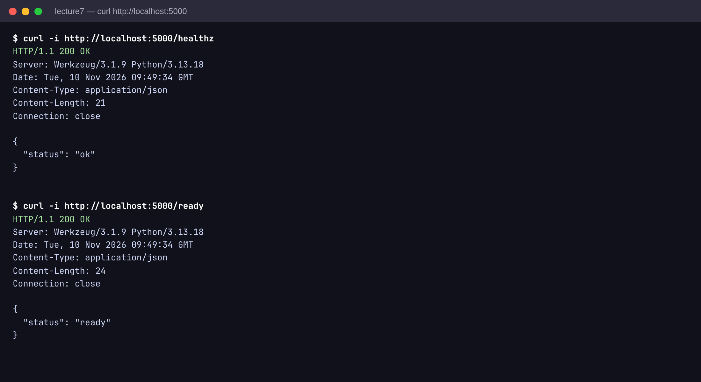
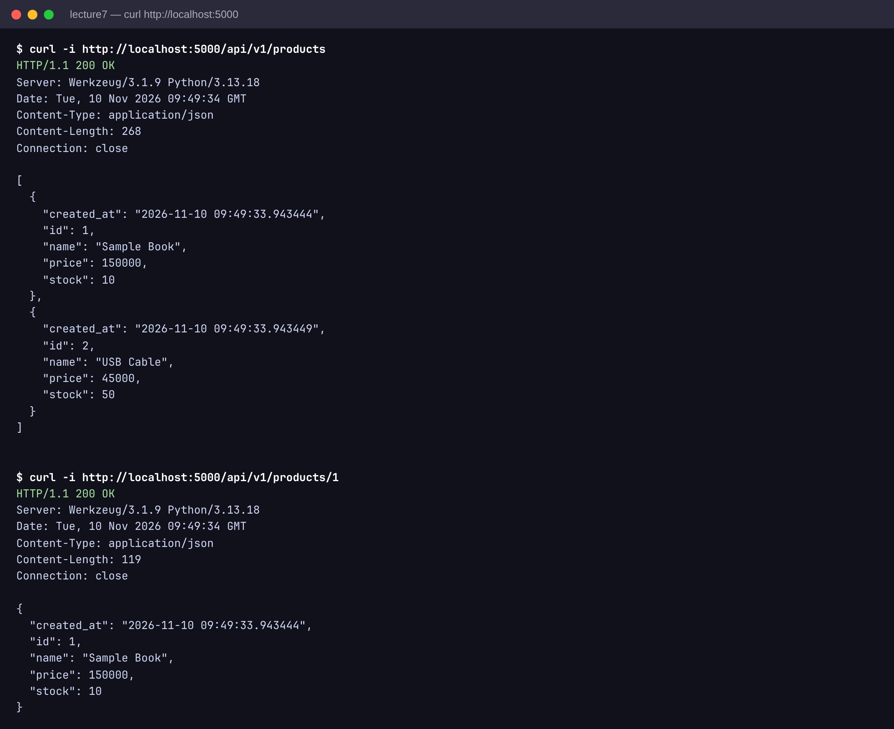
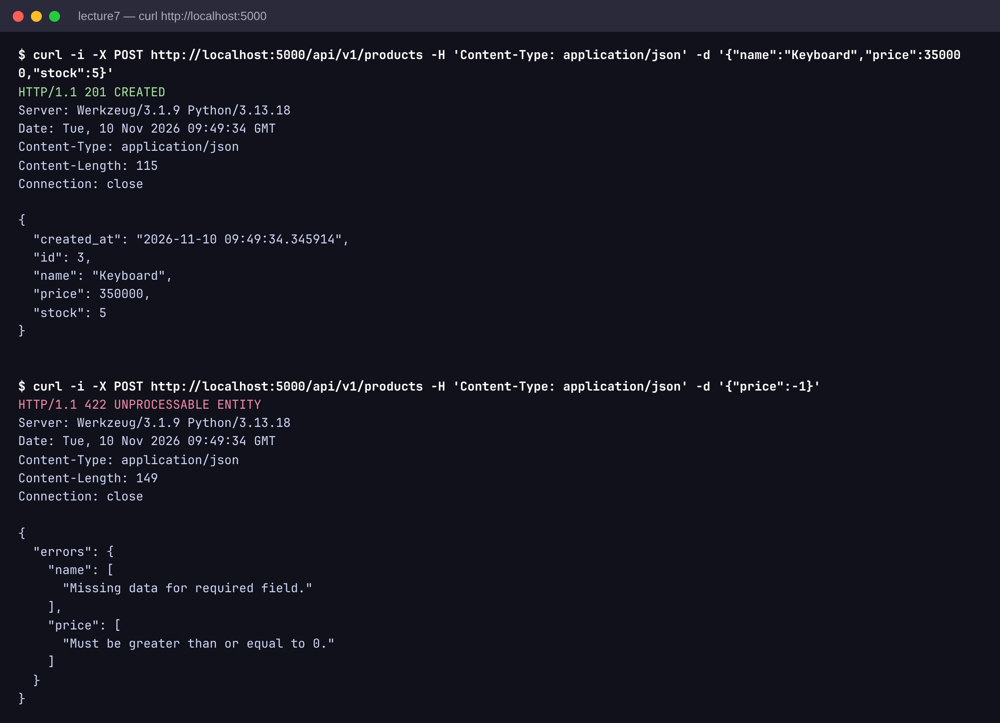
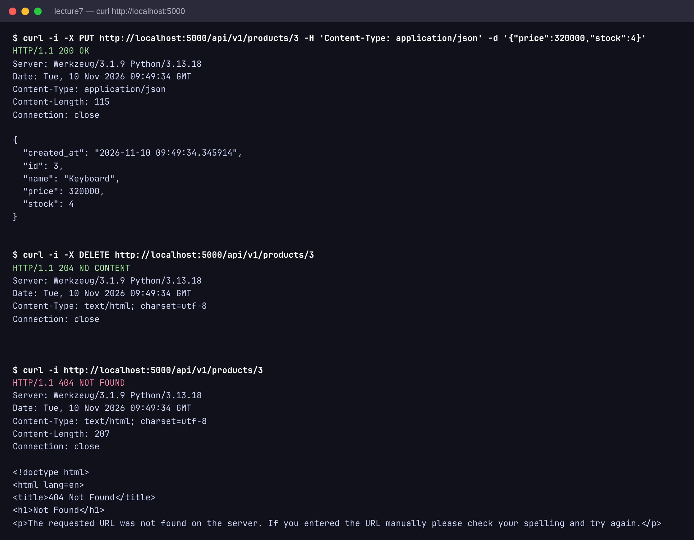

# Lecture 7 - Backend Service

App factory + SQLAlchemy + Marshmallow + Blueprint.

## Local

```
pip install -r requirements.txt
python app.py
```

## Test endpoints

```
curl http://localhost:5000/healthz
curl http://localhost:5000/api/v1/products
curl -X POST http://localhost:5000/api/v1/products \
  -H "Content-Type: application/json" \
  -d '{"name":"Keyboard","price":350000,"stock":5}'
curl http://localhost:5000/api/v1/products/1
```

## Docker

```
docker build -t backend-svc .
docker run -p 5000:5000 backend-svc
```

## Structure

- app.py : factory + health
- extensions.py : db, migrate
- models/ : SQLAlchemy models
- schemas/ : marshmallow
- api/ : blueprints / resources

## Proof

Health check `/healthz` va `/ready`



GET danh sach va chi tiet product



POST tao product 201, validate loi 422



PUT cap nhat 200, DELETE 204, GET lai 404


