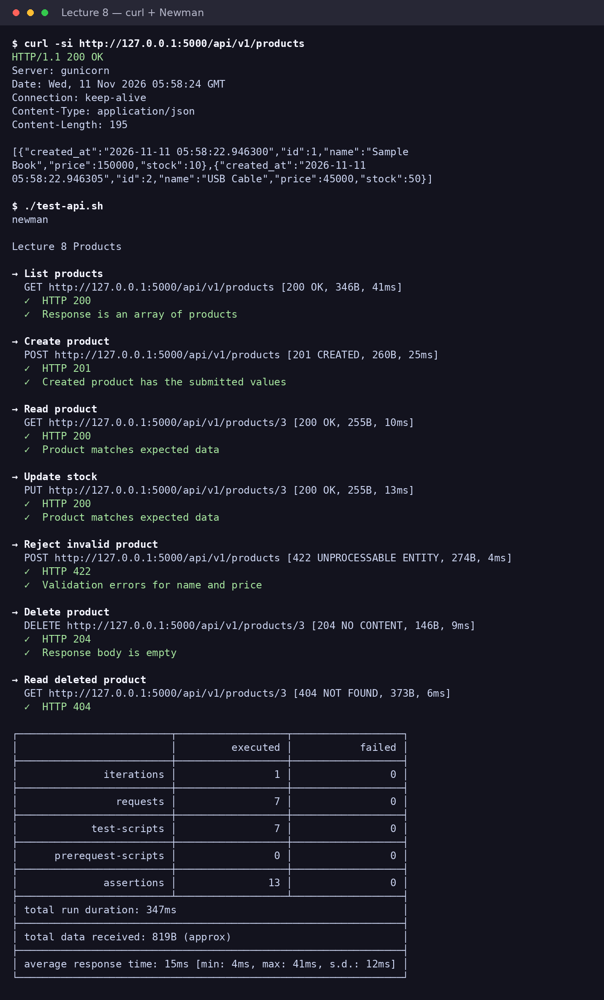

# Lecture 8 - API Testing

- [Lab 1: Kiểm thử Books API bằng pytest](lab01/README.md)
- [Lab 2: Lint OpenAPI bằng Spectral](lab02/README.md)
- [Lab 3: Kiểm thử Books API bằng Newman](lab03/README.md)
- [Lab 4: Đo tải Books API bằng Locust](lab04/README.md)

## Bài tập về nhà — Products API

Newman kiểm thử Products API của Lecture 7. Locust đo tải trên `GET /api/v1/products`.

### Chạy API cục bộ

Cài từ thư mục gốc của repo:

```sh
pip install -r lecture7/requirements.txt -r lecture8/requirements.txt
npm install -g newman@6.2.1
```

Chạy API với một file SQLite riêng cho bài test:

```sh
cd lecture7
DATABASE_URL=sqlite:///lecture8-test.db gunicorn --bind 127.0.0.1:5000 --workers 1 --threads 4 --preload app:app
```

### Test API

Từ thư mục `lecture8`:

```sh
curl -i http://127.0.0.1:5000/api/v1/products
./test-api.sh
```

Có thể import [collection](postman/Products.postman_collection.json) vào Postman và chạy theo thứ tự trong Collection Runner. Collection lấy ID từ response tạo product, dùng ID đó cho GET/PUT/DELETE rồi kiểm tra GET trả 404. Gọi `./test-api.sh <base_url>` để đổi địa chỉ API.



### Load test

Từ thư mục `lecture8`:

```sh
locust -f locustfile.py --headless -H http://127.0.0.1:5000 -u 10 -r 2 -t 30s
locust -f locustfile.py --headless -H http://127.0.0.1:5000 -u 50 -r 5 -t 60s
locust -f locustfile.py --headless -H http://127.0.0.1:5000 -u 200 -r 50 -t 30s
```

Các báo cáo đã lưu gồm [Baseline](reports/baseline.md), [Normal](reports/normal.md) và [Spike](reports/spike.md). Xem nhận xét và SLO đề xuất trong [analysis.md](analysis.md).

Locust in thống kê ra terminal và mặc định trả mã thoát 1 nếu có request lỗi.
