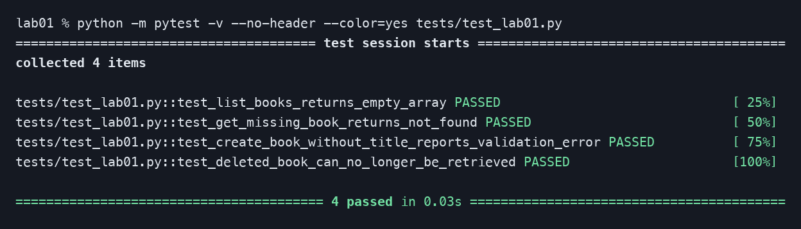

# Lab 1 bước 1 — Kiểm thử Books API

Bốn test dùng Flask test client. Mỗi test có một cơ sở dữ liệu SQLite riêng trong thư mục tạm.

| Ca kiểm thử | Kết quả mong đợi |
| --- | --- |
| `GET /books` khi cơ sở dữ liệu rỗng | HTTP 200 và mảng JSON `[]` |
| `GET /books/9999` khi ID không tồn tại | HTTP 404 với mã lỗi `NOT_FOUND` |
| `POST /books` thiếu `title` | HTTP 400 và `errors` chứa lỗi của trường `title` |
| Tạo sách rồi xóa và đọc lại cùng ID | HTTP 201 khi tạo, 204 khi xóa và 404 khi đọc lại |

Từ thư mục gốc của repo, chạy:

```sh
cd lecture8/lab01
python3 -m venv .venv
source .venv/bin/activate
python -m pip install -r requirements.txt
python -m pytest -v tests/test_lab01.py
```

Chạy `python -m pytest -v` để kiểm tra thêm hai smoke test của starter.

Nguồn API, fixture và smoke test: [lab08-starter](https://github.com/TrinhLK/lab08-starter/tree/b97f793ebf47b6c8a723324bb888f510c64f71ed).

## Kết quả chạy bước 1

Cả bốn test đều pass trong 0,03 giây. Ảnh dưới đây ghi lại đầu ra từ phiên chạy pytest.



## Bước 2 — Kiểm tra trường thừa

Test `test_response_extra_field_blocked` đối chiếu JSON thực tế từ `GET /books/{id}` với schema `Book` của Lab 2. Sau đó test thêm `password_hash` vào bản sao response và kiểm tra `jsonschema` từ chối trường thừa.

```sh
python -m pytest -v tests/test_schema.py
```
