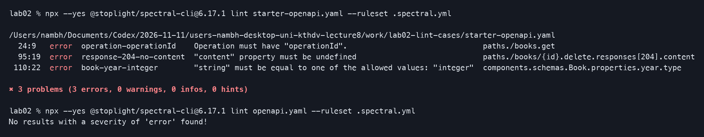

# Lab 2 — Lint OpenAPI bằng Spectral

- Thêm `operationId: listBooks` cho `GET /books`.
- Bỏ `content` khỏi response `204` của `DELETE /books/{id}`.
- Sửa `Book.year` thành `integer` và giữ `nullable: true` để khớp với Books API.

Rule `response-200-has-fields` yêu cầu response `200` có schema JSON với ít nhất một trường. Với response dạng mảng, rule kiểm tra schema của từng phần tử. Rule cũng kiểm tra được schema tham chiếu bằng `$ref`.

```sh
npx --yes @stoplight/spectral-cli@6.17.1 lint openapi.yaml --ruleset .spectral.yml
```

[Kết quả lint](lint.log) của bản đã sửa có 0 vấn đề.

Nếu Flask trả sai trường, dùng pytest và Flask test client để gọi `GET /books/{id}`, kiểm tra HTTP `200` rồi đối chiếu JSON thực tế với schema `Book` bằng trình kiểm tra OpenAPI 3.0. Schema sẽ bắt được trường bắt buộc bị thiếu, trường sai kiểu và trường thừa.


