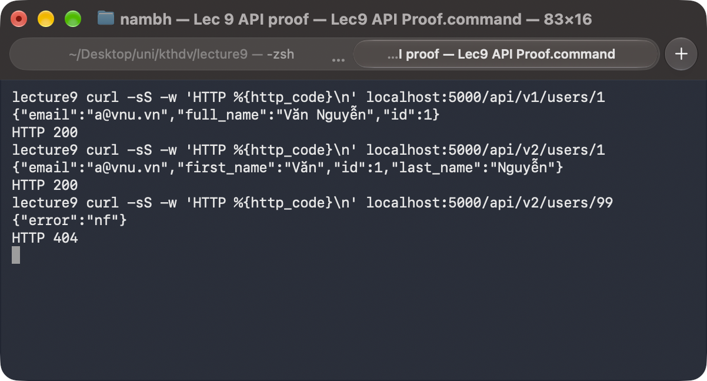

# Lec 9 — URI Path Versioning

Hai Flask Blueprint dùng chung dữ liệu. V1 trả `full_name`. V2 trả `first_name` và `last_name`. ID không tồn tại trả HTTP 404.

Chạy từ thư mục `lecture9`:

```sh
python3 -m venv .venv
source .venv/bin/activate
python -m pip install -r requirements.txt
python app.py
```

Mở terminal khác để thử:

```sh
curl -sS -w 'HTTP %{http_code}\n' localhost:5000/api/v1/users/1
curl -sS -w 'HTTP %{http_code}\n' localhost:5000/api/v2/users/1
curl -sS -w 'HTTP %{http_code}\n' localhost:5000/api/v2/users/99
```


